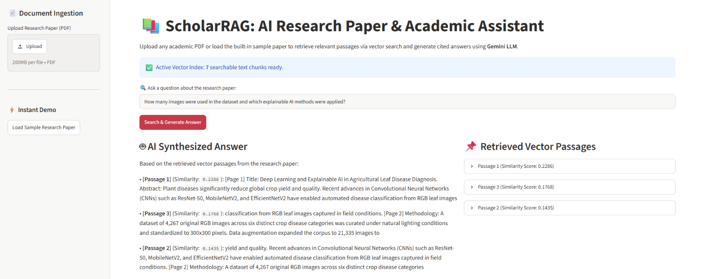

# ScholarRAG: AI Research Paper & Academic Assistant

A Retrieval-Augmented Generation (RAG) document assistant built with **Python**, **Sentence-Transformers (`all-MiniLM-L6-v2`)**, **FAISS**, **Scikit-learn**, **Google Gemini**, and **Streamlit**. ScholarRAG ingests academic PDFs, splits text into overlapping word windows, retrieves top-k passages using either dense vector embeddings or a lexical TF-IDF baseline, and generates source-cited answers.



## Key Features
* **PDF Ingestion & Windowed Chunking:** Extracts text from multi-page academic PDFs with page tracking and splits it into overlapping word windows (120 words, 25-word overlap).
* **Dual Retrieval Engine (Dense vs. Lexical):**
  * **Dense Semantic Search:** Encodes chunks with `sentence-transformers/all-MiniLM-L6-v2` (384-dim L2-normalized vectors) and searches via **FAISS** inner-product index (`IndexFlatIP`).
  * **Lexical Baseline:** Computes **TF-IDF** vectors and ranks chunks by cosine similarity for direct keyword comparison.
* **Source-Cited LLM Synthesis:** Uses Google Gemini (`gemini-2.0-flash` via `google-genai`) to synthesize answers strictly grounded in retrieved passages with inline citations (`[Passage 1]`, `[Passage 2]`).
* **Extractive Offline Fallback:** Automatically returns the highest-scoring retrieved passages with similarity scores when run without an API key.

## Retrieval Benchmark (Dense FAISS vs. TF-IDF Baseline)

Evaluated on the built-in agricultural computer vision sample paper (9 chunks) across 16 factual and paraphrased questions using `evaluate.py`:

| Retrieval method | Hit@1 | Hit@3 | MRR |
| :--- | :---: | :---: | :---: |
| TF-IDF (keyword baseline) | 75% | 88% | 0.82 |
| Dense embeddings (MiniLM + FAISS) | **75%** | **100%** | **0.86** |

* **Observation:** While TF-IDF performs well when query terms match the exact wording in the paper, dense embeddings (`all-MiniLM-L6-v2` + FAISS) consistently rank paraphrased queries higher (e.g., matching *"input photos resized to"* against *"standardized to 300x300 pixels"* at Rank 1 vs. Rank 6 for TF-IDF), achieving **100% Hit@3**.

Reproduce the benchmark locally:
```bash
python evaluate.py --sample
# Or evaluate on your own PDF and custom question set:
python evaluate.py --pdf paper.pdf --questions eval/questions.json